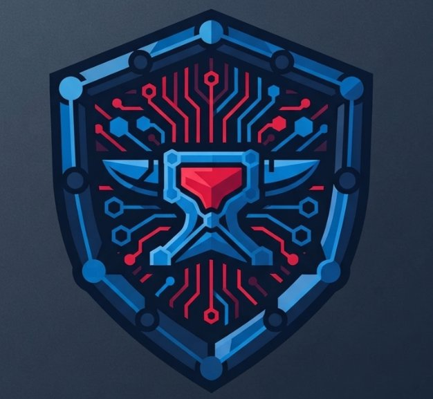

<p align="center">
  
</p>

<h1 align="center">ThreatForge</h1>
<p align="center">
  <strong>Production-Grade Cyber Threat Intelligence (CTI) Aggregator & Defensive Blocklist Engine</strong>
</p>

<p align="center">
  
  
  
  
  
</p>

---

## Overview

**ThreatForge** is an deterministic Cyber Threat Intelligence Aggregator built in Python. It automatically collects, refangs, validates, normalizes, and correlates Indicators of Compromise (IOCs) across heterogeneous feeds—from raw CSVs and TXT lists to standardized **OASIS STIX 2.1 bundles**.

Designed for high-reliability SOC operations and network edge defense, ThreatForge produces hardened, ready-to-deploy firewall rules, DNS sinkholes, proxy blocklists, EDR watchlists, and STIX 2.1 bundles with zero false positives on internal assets and zero AI hallucinations.

---

## Key Capabilities

### 1. Threat Intel Standards & Interoperability
- **Native STIX 2.1 Bundle Support:** Ingests and exports standardized STIX 2.1 indicator objects and bundles (`exports/threat_intel_stix2.json`) with pattern mapping and source provenance.
- **Heterogeneous Parsers:** Ingests CSV, JSON (Feodo Tracker, URLhaus), raw line-delimited TXT (Blocklist.de), and STIX 2.1 feeds.

### 2. Network Resilience & Rate Limiting
- **Circuit Breaker Pattern:** Automatically trips to `OPEN` state after consecutive feed timeouts/failures, preventing hung ingestion pipelines and falling back to cached fixtures.
- **Token Bucket Rate Limiting:** Per-host token bucket limits prevent API quota exhaustion and upstream IP bans.
- **Asynchronous Concurrent Ingestion (`asyncio` + `httpx`):** High-speed parallel fetching with exponential backoff retries.

### 3. Explainable Mathematical Heuristics (Zero AI / ML)
- **Shannon Entropy ($H$) DGA Detection:** Mathematical character bit-entropy evaluation ($H \ge 3.5$) detects algorithmic domain generation (DGAs) deterministically and transparently.
- **Subnet Clustering:** Automatically detects IPv4 `/24` subnet clustering among malicious infrastructure and applies contextual score boosts.

### 4. Production Concurrency & Containerization
- **SQLite WAL Mode:** Multi-worker safe (`PRAGMA journal_mode = WAL; PRAGMA busy_timeout = 10000;`) allowing simultaneous dashboard readers and background pipeline writers.
- **Docker & Docker Compose:** Multi-service composition launching the FastAPI Web UI and a dedicated background scheduler worker.
- **Automated Scheduling Daemon:** `python -m src.cli scheduler` executes periodic ingestion and blocklist regeneration.

### 5. Automated TTL Aging & Expiry Management
- Decays indicator risk scores over a rolling retention window (e.g., 30 days).
- Automatically retires stale indicators to `EXPIRED` status so they drop off active edge blocklists while remaining searchable in SQLite.

### 6. Interactive Web Dashboard & Non-Blocking API
- **Modern Dark-Mode SPA:** Real-time statistics, threat distribution doughnut charts, searchable indicator table, feed management, dynamic allowlist management, and audit logs.
- **Non-Blocking Background Runs:** `POST /api/pipeline/run` returns immediately with a job ID; status can be polled via `GET /api/pipeline/status`.
- **API Key Role Protection:** Optional `X-API-Key` or `?api_key=` authentication for administrative and pipeline endpoints.
- **Dry-Run Diff Preview:** Preview newly added vs expired indicators before pushing updates to production firewalls.

---

## Architecture & Project Structure

```text
ThreatForge/
├── assets/
│   ├── logo.png               # Brand logo
│   └── threatforge_logo.png   # ThreatForge emblem
├── config/
│   ├── feeds.yaml             # Threat feed URLs, formats, and weights
│   ├── allowlist.yaml         # Bogon suppression rules & static safe IPs/domains
│   └── settings.yaml          # Scoring, TTL retention, heuristics & API settings
├── data/
│   ├── ti_aggregator.db       # Embedded SQLite WAL database (auto-created)
│   └── samples/               # Threat feed fixtures (JSON, CSV, TXT, STIX 2.1)
├── exports/                   # Auto-generated defensive blocklists and STIX bundle
│   ├── blocklist_firewall.txt # IPv4 / IPv6 drop list (iptables, pfSense, Cisco)
│   ├── blocklist_dns.txt      # DNS sinkhole format (Pi-hole, Bind RPZ)
│   ├── blocklist_proxy.txt    # Malicious URLs (Squid, BlueCoat, SWG)
│   ├── blocklist_edr.csv      # Malware hashes (MD5, SHA256)
│   ├── threat_intel_full.json # Full enriched JSON feed
│   ├── threat_intel_stix2.json# OASIS STIX 2.1 bundle
│   └── threat_report.md       # Executive markdown intelligence report
├── src/
│   ├── cli.py                 # Main CLI controller (run, diff, stats, lookup, serve, scheduler)
│   ├── api.py                 # FastAPI REST API & Single-Page Dashboard
│   ├── scheduler.py           # Background scheduling daemon
│   ├── pipeline_job.py        # Asynchronous non-blocking background pipeline manager
│   ├── config_loader.py       # Configuration reader
│   ├── models.py              # Strongly-typed Dataclasses & Enums
│   ├── alerting/              # Slack, Teams, and generic JSON webhook dispatchers
│   ├── ingestion/             # Async fetcher, format parsers, resilience circuit breakers
│   ├── normalization/         # Refanger, regex classifiers, heuristics (DGA / Subnet)
│   ├── storage/               # SQLite WAL database & audit repository
│   ├── correlation/           # Scoring engine, multi-source consensus, TTL decay
│   ├── enrichment/            # AbuseIPDB / VirusTotal connectors & TTL cache
│   └── exports/               # Blocklist exporters, STIX bundle exporter, diff calculator
├── tests/                     # Comprehensive test suite (44 unit & integration tests)
├── Dockerfile                 # Container image specification
└── docker-compose.yml         # Web UI + Scheduler service orchestration
```

---

## Quickstart Guide

### 1. Local Setup
```bash
# Clone or navigate to the repository
cd ThreatForge

# Activate virtual environment
# Windows:
.\.venv\Scripts\activate
# Linux/macOS:
source .venv/bin/activate

# Install dependencies
pip install -r requirements.txt
```

### 2. Launch the Web Dashboard
```bash
python -m src.cli serve
```
Open **`http://127.0.0.1:8000`** in your browser to access:
- **Threats & Blocklists:** Search and filter active IOCs, view scores and source provenance.
- **Dry-Run Diff:** Compare active threats against the previous deployment snapshot.
- **Feed Management:** Enable/disable feeds and adjust source weights dynamically.
- **Dynamic Allowlist:** Add or revoke safe IPs and domains with zero downtime.
- **Audit Trail:** Inspect administrative logs for pipeline executions and config mutations.

### 3. Run Pipeline via CLI
```bash
python -m src.cli run
```
Ingests feeds concurrently, executes DGA & subnet heuristics, correlates multi-source consensus, calculates TTL decay, dispatches alerts, and updates all blocklists + STIX 2.1 bundle.

### 4. Preview Dry-Run Blocklist Diff
```bash
python -m src.cli diff
```
Shows indicators added, removed, or unchanged compared to the previous export snapshot.

### 5. Inspect an Indicator
```bash
python -m src.cli lookup 185.220.101.5
```

### 6. Run with Docker Compose
```bash
docker-compose up -d
```
Starts:
- `threatforge_web` on port `8000`
- `threatforge_scheduler` automatically polling feeds every 60 minutes in the background.

---

## Running Automated Tests

Run the complete test suite (44 unit and integration tests):
```bash
python -m unittest discover tests
```
Tests cover:
- STIX 2.1 bundle parsing and bundle generation
- Network resilience: Circuit Breaker state transitions & Token Bucket rate limiter
- Mathematical heuristics: Shannon Entropy DGA detection & IPv4 Subnet Clustering
- Dry-run blocklist diff calculation
- Non-blocking API endpoints, authentication, feed controls, allowlists, and audit logs
- Refanging, bogon suppression, TTL decay, and webhook alerting
